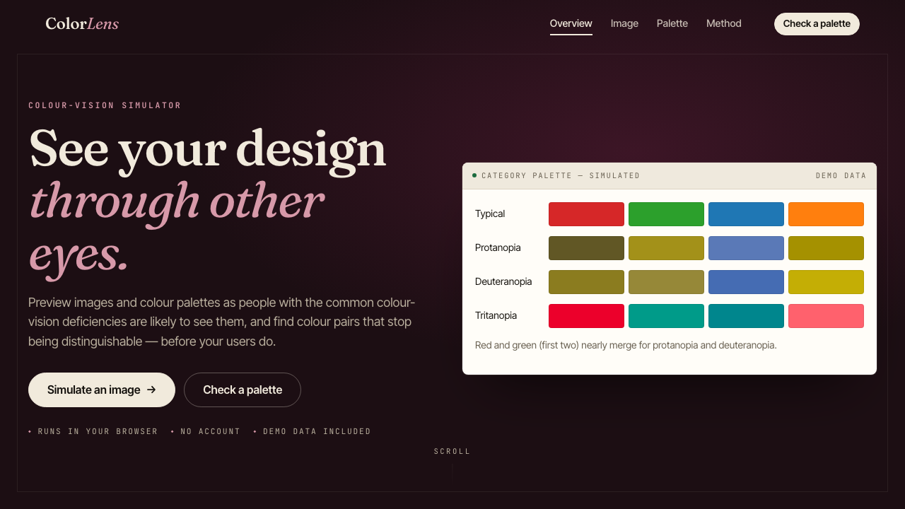
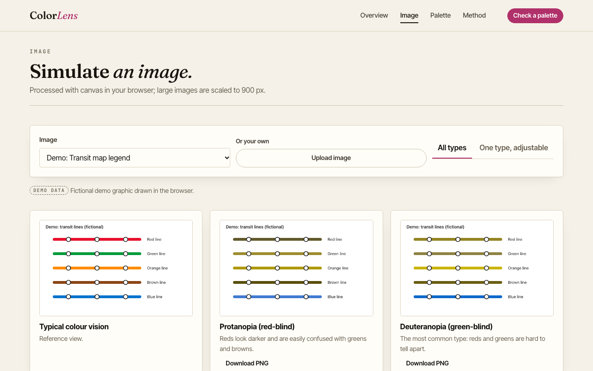
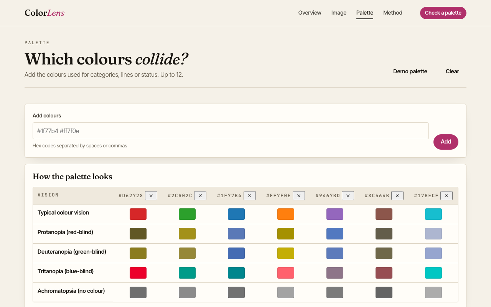
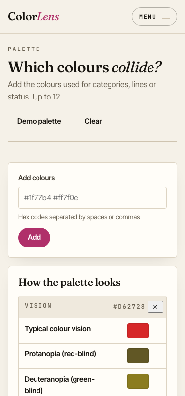

# Color Lens

A colour-vision deficiency simulator. Preview images and palettes as people with protanopia, deuteranopia, tritanopia or achromatopsia are likely to see them, and find the colour pairs that stop being distinguishable.

**Live demo:** [https://color-lens.vercel.app/](https://color-lens.vercel.app/) — runs entirely in your browser; images are never uploaded.



| Image simulator | Palette checker | Mobile |
| --- | --- | --- |
|  |  |  |

## Run it

```bash
npm install
npm run dev        # http://localhost:5224
npm test
npm run build
npm run test:e2e   # Playwright smoke test (npm run e2e:install once if Chromium is missing)
```

## Main workflow

1. **Image** → pick a demo graphic (line chart, transit legend, status lights) or upload your own PNG, JPEG, GIF, WebP or BMP (up to 20 MB, scaled to 900 px).
2. See the original next to all four simulations, or switch to **One type, adjustable** to choose a deficiency and severity (0–100 %).
3. **Download PNG** saves any simulated view.
4. **Palette** → add up to 12 hex colours. A swatch table shows each colour under every type of vision.
5. The pair table lists the CIE ΔE difference for every pair under each deficiency, plus WCAG contrast, with the riskiest pairs first and clashes flagged.
6. The palette, chosen deficiency and severity persist in this browser.

## Rules

- Simulation: sRGB → linear RGB → Machado, Oliveira & Fernandes (2009) full-severity matrix → sRGB. Partial severity blends the matrix with the identity.
- Achromatopsia replaces colour with Rec. 709 relative luminance.
- A pair is a **clash** when its normal ΔE is at least 12 but drops below 12 under protanopia, deuteranopia or tritanopia.
- Invalid hex codes are rejected with the offending values listed; duplicates are ignored.

## Design

Shared editorial system: Fraunces display type, Inter Tight interface text, mono hex values, a berry accent, an ink hero that animates the demo palette through each deficiency, and a warm paper workspace. Motion is removed under `prefers-reduced-motion`.

## Tests

- `src/lib/vision.test.ts` — hex parsing, grey preservation, red/green collapse for protan and deutan, achromatopsia, severity blending, in-place RGBA processing that keeps alpha, Lab and ΔE, palette clash detection, WCAG contrast.
- `src/App.test.tsx` — demo palette clashes, adding with validation and removing colours, image controls in adjustable mode, unsupported upload rejection.
- `e2e/smoke.spec.ts` — landing, demo image processed differently per deficiency, severity slider, a real upload and PNG download, palette add with reload persistence, plus 375px layout checks.

## Limitations

- An educational approximation of average perception, not a diagnostic tool; screens and lighting also change colour.
- Partial severities are interpolated rather than using the paper’s per-step matrices.
- ΔE uses CIE76, which is simpler than CIEDE2000.

## Future improvements

- Suggest accessible replacement colours for flagged pairs.
- Simulate a live web page via screenshot paste.

## Licence

MIT — see [LICENSE](LICENSE).
